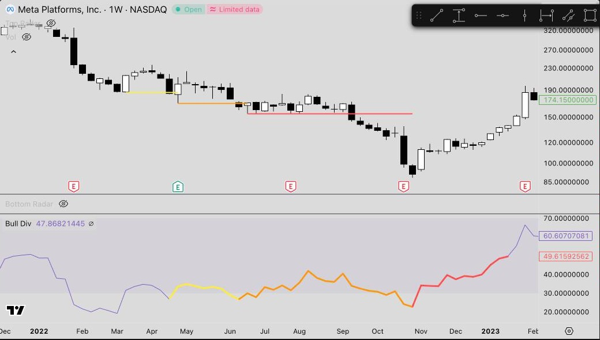

# Bullish Divergence · Weekly (TradingView, Pine v6)

Finds weekly bullish RSI divergences, where price makes a lower low while RSI makes a higher low, and colour-codes each one by how far the setup has developed.



## Rules (defaults)

1. **Setup low:** an RSI(14) swing low **at or under 31**. If RSI never gets that low, nothing is drawn.
2. **Divergence:** a later swing low where **price makes a lower low** than the setup's last low **while RSI stays above the setup low**. How it is drawn (v1.1, Nov 17 2026): **price chart**: a flat bar in the divergence colour (thickness 2) starts at the bottom of the previous low's candle and runs to the divergence-low candle, so you can see price break under it. **RSI pane**: the RSI line changes to that colour (same thickness as the rest of the line, only the colour changes) from the low and stays lit until RSI closes back above 50. No labels, boxes, shading or guide lines; just a very light purple band between 30 and 70 and a light dotted line at 50 (thickness 2). RSI values show 2 decimals. The RSI pane shows at least 10 to 80: two invisible levels at 80 and 10 keep auto-scale from going narrower than that. For an exact 10–80 view, turn off auto-scale on the pane's price scale and set it to 10–80 (readings above 80 then run off the top). The other looks that were tried are in `docs/looks/` and `versions/trial_looks.pine`.
3. **Colour** (the stronger of the count rule and the RSI-level rule):

   | Colour | Hex | When |
   |---|---|---|
   | Yellow | `#E6B800` dark golden on the RSI line, `#FFEB3B` bright on the price chart | 1st divergence |
   | Orange | `#FF9800` | 2nd divergence |
   | Light red | `#FF5252` | 3rd divergence |
   | Red | `#E50000` | RSI low from 33 to 35 (or any 4th+ divergence) |
   | Dark red | `#9B0000` | RSI low above 35 |

4. An RSI low **under** the setup low restarts the setup there. A setup **ends 52 weeks** after its setup low.
5. A swing low = the lowest RSI of the 5 weeks before it and the 2 closed weeks after it, so each signal appears **2 weekly closes after the low**. Only closed weeks are used, so nothing repaints once drawn.

Every level, colour, price-chart bar thickness (default 2; the RSI line is always 1) and window is an input. Alerts: any divergence, red or dark red, dark red only, and new setup low. An `alert()` message also names the colour.

## Files

- `bullish_divergence.pine`: the indicator (saved in TradingView as "Bullish Divergence · Weekly", script version 23). To use it, open the Pine Editor in TradingView, paste the file, save and add it to a weekly chart.
- `versions/`: the trial looks and an older version, kept for reference.
- `LICENSE`: MIT.
- `backtest/div_lab.js`: a Node copy of the logic for Yahoo weekly bars. On HIMS, SPY and META it matched TradingView divergence for divergence (Nov 13 2026).

```bash
node backtest/div_lab.js <dataDir> SPY QQQ         # list setups + divergences
node backtest/div_lab.js <dataDir> --stats         # price after each colour
```

**Forward check (Nov 14 2026):** `node backtest/forward_check.js <dataDir> <out.csv>` lists every signal with the price 6 months and 1 year later and compares with the same stocks' normal 6-month/1-year moves. On today's top 50 S&P 500 companies: 271 signals; 6 months later median +13.3% (normal: +7.1%), 1 year later median +23.1% (normal: +13.2%). Full list: `backtest/top50_forward.csv`.

**Same check on companies worth $3–10 billion (Nov 14 2026):** 802 US-listed companies (Nasdaq screener), 3,546 signals on 646 of them. 6 months later median +5.3% (normal +4.4%), 1 year later +10.4% (normal +8.4%), up 57% / 60% of the time (normal 58% / 61%): no real edge outside the mega caps. Full list: `backtest/midcap_3to10B_forward.csv` (averages are distorted by a few corporate-action outliers; use medians).

## Scanning a list of stocks

`backtest/scan_now.js` runs the indicator's rules on every stock in a list and sorts them into: **confirmed** (divergence drawn in the last 8 weekly closes), **forming** (possible RSI swing low in the last 1–2 weeks above the setup low with price under the last low, waiting for its 2 confirming closes), **undercut** (price already under the last low with RSI above the setup low, no counted RSI swing low yet) and **watch** (live setup, latest low 0–10% above the last low).

```bash
node backtest/scan_now.js <dataDir> <meta.json> <out.csv> 8
```

Yahoo stamps weekly bars on Thursdays for some old NYSE stocks (MMM, KO, XOM, JNJ, …). Those bars don't match TradingView's Monday–Friday weeks, so rebuild them from daily bars first. The S&P 500 scan of Nov 14 2026 is in `scans/`. The history of every S&P 500 signal is in `backtest/sp500_forward.csv`.

`backtest/max_high_1y.js` measures, for every S&P 500 signal, the highest price in the 52 weeks after the signal week (vs. any random week). Results: `backtest/sp500_max_high_1y.csv`.
